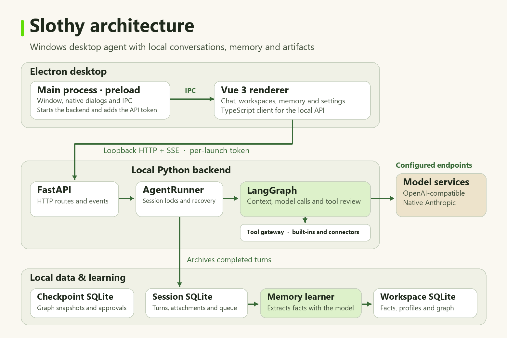

<p align="center">
  
</p>

<h1 align="center">Slothy · 思洛</h1>

<p align="center"><em>Small Steps Toward A Better Future · 小步迭代，迈向更好未来</em></p>

<p align="center">
  
  
  
  
  
</p>

<p align="center">
  <a href="docs/architecture.md">Architecture</a> ·
  <a href="docs/getting-started.md">Getting started</a> ·
  <a href="docs/api.md">API</a> ·
  <a href="docs/brand.md">Brand</a> ·
  <a href="README.zh-CN.md">简体中文</a>
</p>

<p align="center">
  <a href="https://github.com/Mzys521/slothy/releases/tag/v0.1.6"><strong>Download Slothy 0.1.6 for Windows x64</strong></a> ·
  <a href="docs/releases/0.1.6.md#english">Release notes</a> ·
  <a href="CHANGELOG.md">Changelog</a>
</p>

---

**Slothy** is a local-first adaptive personal agent for the desktop. It pairs a
native Electron shell with a FastAPI + LangGraph service running on your own
machine, so conversations, long-term memory, user profile and artifacts stay in
local SQLite files instead of a cloud account.

An independent background LLM evaluates completed turns for preferences, habits,
goals, facts and episodes. Reliable, evidence-backed information is saved automatically
and projected into a versioned profile; uncertain or sensitive candidates remain
reviewable. Fully manual review is also available. Each request retrieves relevant
memory. Tool calls that change your machine are reviewed by you, not trusted
blindly.

## Memory V3

The background model extracts typed concepts and evidence-backed relations. Python
and beginner are separate concepts; proficiency belongs to Python, not to the user
as a generic label. Concepts and facts have independent, session-deduplicated
frequencies and strength `f/(f+4)`. SQLite FTS5, aliases and one-hop relation recall
need no embedding service. Manual profile edits and automatic learning share the
same facts; corrections retire old versions, and identity questions use reliable
facts directly. The context panel shows what was actually provided and why.

Slothy 0.1.6 checks existing databases before opening them. It opens compatible data
and prompts for a recovery decision when the storage format needs attention. Upgrading
a compatible legacy store through that prompt creates a verified backup first.
See the [0.1.6 release notes](docs/releases/0.1.6.md#english) for upgrade and installer details.

## Why Slothy

| | |
|---|---|
| **Local-first by design** | Sessions, memory, profiles and artifacts live in local SQLite; the desktop API binds to `127.0.0.1` with a per-launch token that never reaches the renderer. |
| **An agent you can audit** | Every run is checkpointed step by step. You can pause on a tool call, inspect the exact arguments, approve or reject it, and resume the same run. |
| **Memory with provenance** | A memory is a claim plus evidence plus a scope. Reliable information is saved automatically; you can review, edit, archive or delete it. Deletion redacts references and blocks resurrection during historical reanalysis. |
| **A real desktop product** | Frameless window, native file dialogs, workspace folders on disk, NSIS installer, offline data directory, DPAPI-encrypted provider keys. |
| **Built to be maintained** | Strict layering, deterministic prompt assembly, full backend/frontend regression suites, production asset audit, and bilingual architecture/API documentation. |

## Features

- **Agent runtime** — LangGraph `StateGraph` with the nodes
  `prepare_run → decide → load_profile → retrieve_memories → build_personalized_context →
  agent → (tools) → finalize_response`, synchronous checkpointing and bounded
  recursion.
- **Human-in-the-loop tools** — risky tool calls pause the graph through an
  `interrupt()`; approve or reject, then resume with `Command(resume=…)`.
- **Reasoning trace** — when the provider returns reasoning text it streams in a
  separate collapsible block above the answer, auto-collapses once reasoning finishes,
  and is archived with the turn; it is display-only and never injected into prompts or
  message content.
- **Decision model in API settings** — pick any configured provider/model to drive routing,
  tool selection and context planning; leave it off for chat-model self-driving, with
  automatic handoff to the chat model if a decision call fails.
- **Opt-in model catalog** — provider discovery only lists models; nothing is imported
  automatically. Users search, multi-select, and run a tiny real API test per model before
  adding; failures stay selectable with their reason, and existing configured models are
  never overwritten by a refresh.
- **Observability** — rotating application logs and per-session JSONL model-call records
  capture prompt/context composition, tool schemas, provider usage, cache hits, duration,
  status and redacted parameters. Work Details shows an estimated input donut chart,
  provider-reported usage, and details by model call. About Slothy opens the log directory.
- **DeepSeek web search** — the `deepseek_search` tool calls DeepSeek's official
  `POST /v1/tools/search` API (title, URL, summaries, content, source, publication time).
  Configure an independent Search key in Settings → API; otherwise the DeepSeek model
  key is reused. With neither key the tool is not registered, so ordinary chat is unaffected.
- **Native MiMo web search** — supported MiMo v2.6 models receive the provider's own
  `web_search` tool by default; if the account plugin is disabled the request transparently
  retries without search.
- **Reviewed high-risk tools** — risky calls pause immediately for the runtime approval
  dialog; the model never asks for confirmation in prose. Denials are returned as
  `USER_DENIED` tool results, recorded as rejected in audit/activity, and cannot be
  retried or bypassed in the same run.
- **Work artifacts** — completed replies list the files written or generated
  during the turn. Click a card in the desktop app to open the original file.
- **Document reading** — drop PDF, DOCX, PPTX or UTF-8 files into a conversation, or use `@`
  to reference a file in the workspace. Apply OCR to scanned PDFs and save legacy `.doc` or
  `.ppt` files as `.docx` or `.pptx` before sharing them with the Agent.
- **Reviewed deletion** — `workspace_delete` is a Chat/Work high-risk tool: paths are
  normalized and confined to the workspace, symlinks/roots/private paths are rejected,
  recursive deletion requires explicit approval, and the target is revalidated at
  execution time.
- **Clear local data** — About → Local data removes conversations, memory, profiles,
  indexes, databases, checkpoints, caches, logs and local configuration after an exact
  `确认删除` confirmation; failures and residue are reported instead of a false success.
- **Model-driven decisions** — an optional dedicated decision model proposes the
  route, tool subset and context budget; deterministic guards clamp it, `off` /
  `shadow` / `enforce` control rollout, and rules are the fallback. The plan never
  bypasses approval and stays out of the prompt cache.
- **Composer commands and references** — `/` and the plus button share a menu for
  20 commands and file upload; `@` selects workspace files/folders, conversations
  and plugins. Compression/export require confirmation, references remain bounded
  L3 data, and plugin execution keeps its existing approval policy.
- **First-run onboarding** — a centered, theme-aware glass overlay guides the
  first launch: pick a provider template (DeepSeek, MiMo, OpenAI, Anthropic, Kimi
  or Qwen) or connect a custom endpoint, then drop into the workspace. It only
  appears while no provider is configured; failures offer retry instead of
  pretending the app is unconfigured.
- **Connectors** — configure and test MCP servers over stdio, Streamable HTTP,
  or SSE. Create Skills with Markdown and reference files. Import existing JSON
  and ZIP files and inspect tool definitions. Agent calls to imported tools require approval.
- **Message previews & copy** — SVG/HTML previews fill the conversation width with
  content-driven height and follow the live theme; per-message copy uses the
  native clipboard bridge with browser fallback.
- **Appearance** — Slothy green by default, a persistent custom accent with HEX
  validation and readable light/dark contrast, plus a language switch on the
  welcome screen.
- **Long-term memory V3** — the background model extracts typed concepts and
  evidence-backed directed facts; per-session frequency dedupes and strengthens them
  (`f/(f+4)`). SQLite FTS5, aliases and one-hop relation recall need no embedding
  service, identity questions answer from reliable facts, and manual edits share the
  same fact service as autonomous learning.
- **Versioned profile & facts** — concepts, facts, preferences, habits and goals
  project into an immutable profile history; explicit corrections supersede old
  versions, deletion removes evidence and historical profile bodies, and the next
  turn injects only the scoped current version with source IDs.
- **Layered prompt & cache** — L1 stable system rules + session-frozen profile
  snapshot, L2 append-only history with periodic summaries, L3 the volatile
  per-turn references at the tail. Stable prefixes stay byte-identical across
  turns for provider prefix caching.
- **Built-in tools** — calculation, paged workspace reads and literal search,
  reviewed file writes, template export (md/txt/csv/json/docx), timezone lookup,
  reviewed Python execution and uploaded-file reads. Work has 10 tools; Chat has 8
  (the optional DeepSeek search tool is added only after a Search key is resolved).
  Results, artifacts, risks and per-tool measurements use one contract;
  journaled writes can be recovered without repeating completed effects.
- **Optional HTTPS retrieval** — disabled by default; requires an explicit domain
  allowlist and rejects non-public addresses and unsafe redirects.
- **Workspaces on disk** — each workspace maps to a real folder; tool instances
  and artifact roots are isolated per directory, without changing the process
  working directory.
- **Conversation forks** — fork a conversation with its archived turns and artifact
  links.
- **Model providers** — DeepSeek, MiMo, Anthropic and any OpenAI-compatible
  endpoint; keys are stored with Windows DPAPI and only masked state is exposed
  to the API.

## Architecture at a glance



See [Architecture](docs/architecture.md) for the module map, graph topology,
prompt layering, storage schema and security boundaries.

## Quick start

Requirements: **Windows 10/11 x64**, Python **3.11+**, Node.js **20+**, npm.

```powershell
# 1. clone
git clone https://github.com/Mzys521/slothy.git
cd slothy

# 2. backend environment
cd core
python -m venv .venv
.\.venv\Scripts\Activate.ps1
python -m pip install -e ".[dev]"
Copy-Item .env.example ..\.env      # then edit ../.env and pick a provider

# 3. desktop app
cd ..\web
npm install
npm run dev
```

`npm run dev` starts Vite and Electron; the Electron main process launches the
local backend from `core/.venv`, injects the per-launch token and opens the
window. On first run the setup overlay appears while no provider is configured —
pick a template or a custom connection (DeepSeek, MiMo, OpenAI, Anthropic, Kimi,
Qwen or any OpenAI-compatible endpoint), save the key, and the workspace opens.
Later changes live under **Settings → API**.

Install and package details, environment variables and troubleshooting live in
[Getting started](docs/getting-started.md).

## Project layout

```text
core/                  Python backend (FastAPI + LangGraph)
  app/api.py           HTTP routers, SSE, lifespan wiring
  app/agent/           graph, tools, providers, prompt planning
  app/memory/          memory learning, evidence, profiles and graph
  app/infrastructure/  SQLite stores, LLM adapters, subprocess runner
  tests/               backend regression tests
web/                   Electron + Vue desktop client
  electron/            main process, preload bridge, backend supervision
  src/                 Vue pages and TypeScript API layer
docs/                  public documentation (EN + 中文) and diagrams
```

## Quality

```powershell
cd core
.\.venv\Scripts\python.exe -m pytest
.\.venv\Scripts\python.exe -m ruff check app tests

cd ..\web
npm run typecheck                         # vue-tsc
node --test tests/*.test.mjs electron/directory.test.mjs
npm run production:audit                  # packaged-asset allowlist audit
```

## Security & privacy

- The API listens on `127.0.0.1` only and rejects requests without the
  per-launch token; the renderer never receives that token.
- Provider keys are encrypted with Windows DPAPI and never returned by the API.
- The tool runner uses an explicit command allowlist, argv-only execution, a
  minimal environment and bounded output; generated documents run in a separate
  Python process with path and import policies.
- Chat inference is sent only to the model endpoint **you** configure. Slothy
  itself has no cloud backend and no account system.

## Roadmap

- [ ] Scheduled memory consolidation with decay and retention enforcement (settings
  are reserved today; automatic permanent deletion is not enabled).
- [ ] Richer memory retrieval (optional embeddings, hybrid ranking).
- [ ] More providers and richer cache analytics in the UI.

## Documentation

| Document | English | 中文 |
|---|---|---|
| Architecture | [architecture.md](docs/architecture.md) | [architecture.zh-CN.md](docs/architecture.zh-CN.md) |
| Getting started | [getting-started.md](docs/getting-started.md) | [getting-started.zh-CN.md](docs/getting-started.zh-CN.md) |
| API reference | [api.md](docs/api.md) | [api.zh-CN.md](docs/api.zh-CN.md) |
| 0.1.6 release notes | [English](docs/releases/0.1.6.md#english) | [简体中文](docs/releases/0.1.6.md#简体中文) |
| Brand guidelines | [brand.md](docs/brand.md) | [brand.md](docs/brand.md#中文) |
| Changelog | [CHANGELOG.md](CHANGELOG.md) | [CHANGELOG.md](CHANGELOG.md) |

## License

MIT — see [LICENSE](LICENSE). © 2026 Slothy contributors.

<p align="center">
  
  <br />
  <sub>
    <span style="color:#60DD06">Green is action</span> ·
    <span style="color:#FCEAC9">Cream is warmth</span> ·
    <span style="color:#95611F">Brown is identity</span>
  </sub>
</p>

